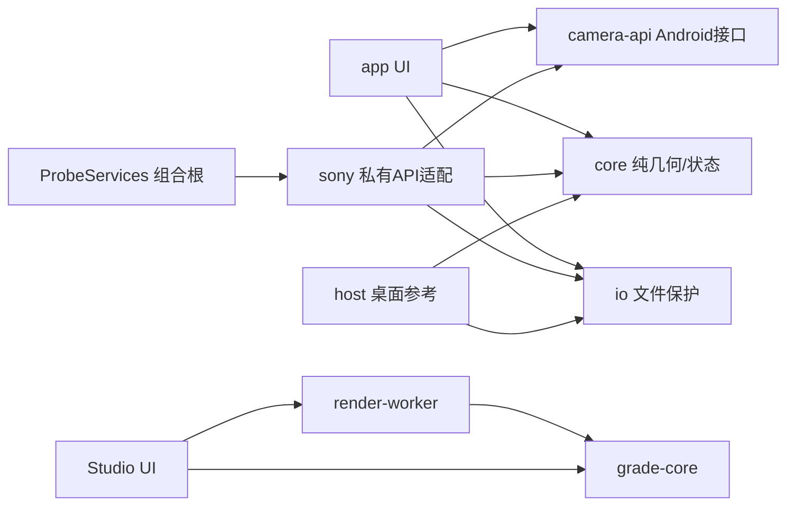

> **v0.6修订优先：** 后端主线改为原生颜色持久化，同时保留实时样张创作。参见 `15_NATIVE_PERSISTENCE.md` 和 ADR0011。下文的软件主线/永不持久写入/所有机身API10表述作为历史设计，不覆盖新决定。实现状态仍以 PROJECT_STATUS 为准。

# 02｜模块化架构与依赖契约

## 架构选择
单仓库、模块化单体；进程内接口组合。无需微服务，也不为了“解耦”引入网络、反射插件系统或复杂 DI 容器。

当前模块是物理源码根和分开编译单元，不只是按目录摆放。`config/modules.json` 定义唯一依赖图；主机编译为每模块单独 classpath；真实 SDK 构建入口使用同样策略，已经在Mac以API10构建并验签；设备接口仍未实测。

| 已建立模块 | 职责 | 允许依赖 | 明确禁止 |
|---|---|---|---|
| core | 几何、捕获状态、纯数据、诊断端口 | Java 基础类型 | Android、文件操作、Sony、AWT、UI |
| io | 文件安全、JPEG 输入守卫、错误脱敏 | Java 基础 IO | UI、Sony、Android、新版 Java 平台 API |
| camera-api | 相机控制端口、显示描述 | core、必要 API10 Android类型 | Sony 具体类、UI、桌面实现 |
| sony | SonyCameraAdapter、设备/按键检测 | core、io、camera-api、API10 | app、桌面实现、直接 UI 更新 |
| app | 工程探针页、用户动作、组合根 | core、io、camera-api；仅组合根接 sony | 界面直接反射/操作 Sony、Java2D |
| host | 桌面像素验证/人工靶 | core、io、Java2D/ImageIO | 被 APK 任何模块依赖 |
| tests | 既有主机回归与对照驱动 | core、io、host | 打入产品 APK |

`ProbeServices` 是当前唯一装配点：创建具体 SonyCameraAdapter，把日志回调注入，在其他 UI 页只暴露 CameraSession。CameraSession 位于 Android 边界模块，允许 SurfaceHolder；不要虚称整个系统完全不依赖平台类型。未来需要多平台时再拆分该边界，不现在过度抽象。

## 本轮实际改动
- 原 core 中 Filesafe/JpegGuard 迁往 io，核心不再兼任文件层。
- SonyCameraAdapter/DeviceProbe 迁往 sony；KeyResolver 集中读取 ScalarInput；UI 不再保存私有类名。
- 抽出 CameraSession、PreviewSize、DisplayInfo；UI 依赖契约而不是具体 Sony 实现。
- Diagnostics 通过构造注入；sony 不再反向引用 ProbeLog。
- 构建脚本使用同一模块图；依赖循环、越层 import 与禁止类名有自动检查。

这不是已经完成最终产品架构：PreviewBackend、ColorAdapter、ExportBackend、JobRepository 等仍属下述后续拆分。既有单拍探针与安全边界不因移动文件而获得新硬件能力。

## 后续按功能增长，不先造空框架
1. `color-domain`：不可变配方数据、版本、能力要求、requested/effective plan。纯 Java，不带 Android、不写机身。
2. `color-sony`：实际参数读写、参数验证与恢复。可先作为 sony 内独立包，达到足够规模再分构建模块。
3. `export-api`：输入身份、CropPlan、输出规格与结果。`export-sony`、可选 `export-native`、主机参考各实现同一契约。
4. `workflow`：捕获意图冻结、保存确认、任务状态与恢复；依赖端口，不直接触碰 CameraEx 或 SQLite。
5. `storage-android`：SharedPreferences/SQLite、媒体查询与输出发布。平台持久化组件复用，不自造数据库。
6. `app-product`：最终拍摄界面；`app-probe` 可以继续独立维护，不把工程探针按钮堆进产品。

先完成一个端到端用例，再按可替换、可测试的边界抽取。仅有一个后端时也可通过简单接口隔离风险，但不创建几十个空接口。

## 不可破坏的业务契约
- lens.squeeze 与 targetAspect 独立；普通镜头1×绝不为填满画框而拉伸。
- 65:24 使用有理比例；源尺寸读实际文件；裁切、显示和输出共用 Geometry 的计划。
- 快门接受时冻结 CaptureIntent：镜头、几何、方向、配方及其有效参数、源关联 token、输出策略。
- 原始文件确认不是收到回调；参数应用确认不是 UI 名称改变；导出完成不是只写了文件头。
- RAW 的传感器采样不会被 JPEG 后期“反挤压成 RAW”；曝光改变可能影响 RAW。
- 未支持的方向/色彩/媒体类型明确拒绝或保留原片，不悄悄降级。

## 线程、生命周期和资源
当前探针按既有 Android 生命周期串行调用相机，不增加未经验证的并发。最终设计为一个相机控制串行通道、一个导出工作槽、主线程 UI 消息。Sony API 是否线程绑定必须机测；“放进工作线程”不是通用修复。

输出任务只保存冻结的小型参数与路径，不积压大 Bitmap。对每个原生句柄明确所有权、释放线程、关闭顺序；不把 DeviceMemory 当 byte[]。取消只到安全点，退出释放相机；关机后不声称后台继续执行。

先用平台 SQLite 事务保存任务，再用新路径写临时文件、校验、发布最终文件；磁盘与数据库不是跨系统原子事务，要通过幂等重启恢复协调。路径身份和文件哈希策略在安全/测试规范中定义。

## 能力是数据，不是机型名单
每项状态 `unknown / declared / probed / verified / failed / unsupported`，并附：机身、固件、显示输出、镜头、输入格式、软件提交和证据路径。背屏/EVF、JPEG编码/索引、源保存/衍生图分别记录。

## 架构检查边界
检查器是我们依赖规则的小型脚本，不是自研编译器。其词法检查与分模块 javac 相互补充，不能证明线程安全、动态反射安全或 API10 的全部方法可用。SDK编译、DEX引用检查和机测仍必须保留。

## Studio与未来颜色能力的解耦

Studio独立于Android构建：grade-core负责软件颜色数学与LUT，render-worker负责有界像素任务，ui负责交互与请求序号；template/构建脚本生成单文件HTML，不手改生成物取代源文件。原生look-core语义草稿与软件LUT协议保持区别。它通过数据契约与未来相机导入器衔接，不通过跨平台全局状态调用Sony。

图中箭头表示依赖；最终依赖以config/modules.json和实际源码为准。camera-api含SurfaceHolder，不是跨平台纯核心。NativeLookCompiler应无副作用，NativeColorStore只在Sony边界，发布流程通过接口串行协调；这些为后续职责，尚未实现时不建立空模块冒充完成。
