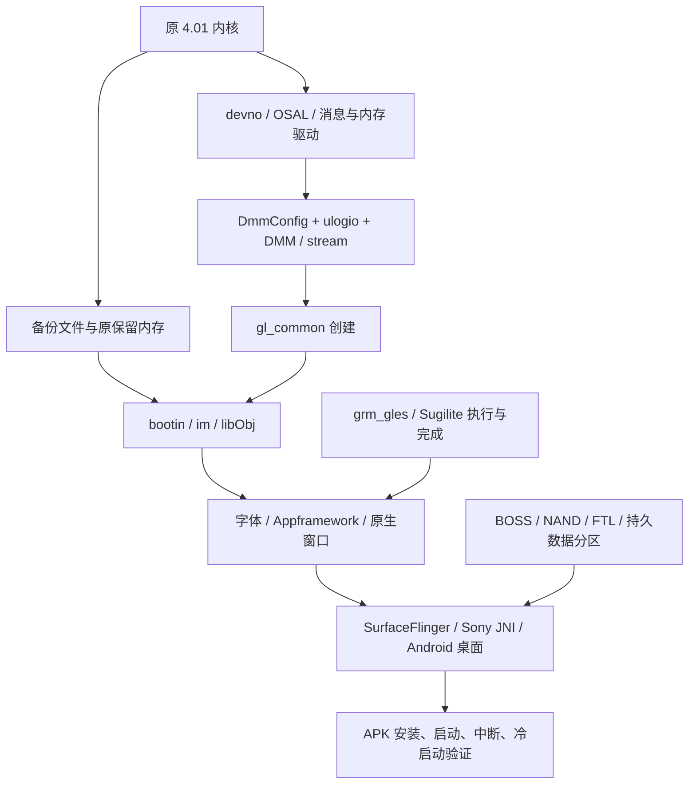

# 技术链路与当前断点

更新：2026-10-23。以下是自行整理的技术事实与契约，不包含原厂程序、反汇编清单或固件载荷。Rxx 对应[证据索引](EVIDENCE.md)。

## 1. 环境分层：三个“能运行”不能混用

| 层 | 当前实现 | 适合验证 |
|---|---|---|
| 主机检查与局部回放 | Java/Python/Node 检查、有限固件方法解释、故障注入 | 自有逻辑、已还原分支、资源契约 |
| 背面操作台 | 网页外壳，启动独立实验，展示日志 | 操作组织、实验状态、后续交互原型 |
| 原固件系统实验 | 定制 QEMU + 原 4.01 内核和部分用户态输入 | 已建模 CPU/外设及实际服务链行为 |

完整模拟器需要第三层真正驱动窗口、Android、数据存储和输入。前两层不能用来替代它。

硬件约束来源及未确定项：

| 项目 | 目前依据 | 限制 |
|---|---|---|
| CPU | OpenMemories 记录 CXD90014 为四 Cortex-A5；固定 QEMU 板型创建一个 Linux CPU | 不是完整四核/协处理域仿真；CPU 主频和执行时序未标定 |
| RAM | 4.01 kemco/板型对应 1 GiB 物理地址空间和多个保留区；一轮实际 Linux MemTotal 为 201516 kB | 1 GiB 不等于 Android 可自由使用内存；实验 initrd 影响余量 |
| 存储 | 原 partinf：设置约 13 MiB、Android 数据约 99.75 MiB，逻辑分区末端 438.75 MiB | 不等于确证物理闪存总容量；64 MiB 合成 NAND 只用于控制器测试 |
| 显示 | 原 WindowServer 日志为 640×480、双缓冲 | 不是对所有 LCD/EVF/录像格式的统一规格 |
| 系统 | 原文件为 Linux 3.0.27 系列、Android 4.1.2 / API16 / ARMv7 | 应用采用 API10 构建底线，不能把构建底线写成机身 Android 版本 |

CPU 百分比限速、TCI 耗时和 BogoMIPS 均不能直接换算真实录像帧率。容量、带宽、计算时间和调度时序需要分开校准。[硬件来源及具体约束](../VIRTUAL_CAMERA.md)。

## 2. 原生启动依赖

下图表示已追踪依赖，不宣称整个链已经运行成功，也不代替原启动脚本的精确先后关系：



关键定位顺序（R07–R14）：

1. Android 缺 OSAL 时，gralloc 路径有实际空指针故障，消息分配返回 -9。补原模块后变为等待 Sony 窗口连接。
2. 原生核心创建 `gl_common` 时，缺 MA 回调得到 -1020；补回调后消息发送可返回 0，但下游创建仍返回 -9999。不能只读外层返回值。
3. DMM 依赖 `DmmConfig.bin` 和日志记录区；原 `filp_open` 对缺失 `/setting/ulogio.bin` 返回 -2。通过匹配暖启动数据恢复配置后，相关初始化正常推进。
4. 补原 stream、节点、字体后，窗口表面创建成为后续停点。原 GPU 驱动要求的上电读回值与空 MMIO 不符。
5. 有限控制模型使驱动加载，但任务完成仍未产生；上层窗口不能因此验收。

注意 `libObj.so` 内嵌的原生 DMP 代码与 Android 的独立 `libDMPAlloc.so` 是不同对象。共享名称和类似调用不自动证明函数体、内存池或实际运行阶段相同。最新 A6000 分配器比较针对 Android 共享库，不能替代原生启动断点。

## 3. Sugilite：已知提交和消费端，未知硬件完成端

已观察的首个提交为四组单值命令，每组 8 字节，共 32 字节（R13/R14/R20）：

| 命令 ID | 原调试信息名称 | 已核对数据或作用边界 |
|---|---|---|
| `0x116` | CU_DUMMY_READ_ADDR | 缓冲物理地址右移 4 位；不能据此推断实际读取宽度 |
| `0x117` | CU_DUMMY_READ_START | 尾部构造写 1；启动后的事务规则未闭合 |
| `0x44` | RAS_ITERATOR | 值取决于构造分支，不能统一硬编码 |
| `0x10` | SYS_FRONT_PORT0 | 包含 `0x12345678`；不是任意目标内存的完成标记 |

原 `rm_reg_kick_3d` 将描述项 +4 写入 MMIO 偏移 `0x1804`，再把 +8 写到 `0x1800`。现有观察器在提交后读取虚拟 RAM 并解析格式；没有执行指令副作用、DMA 写回、渲染或完成中断。

128 字节对象以 128 对齐分配，CPU 写入 64 个 `0xff00` 半字；符号是 `dmp_error_tex_buffer_id`，曾确认用于备用纹理和虚读引用。大小和初值都不是“GPU 应将它覆写成成功”的依据。

完成链应分段理解：

```text
软件构造 → 提交寄存器 → GPU 实际读取/处理/写回
                        [缺：事务结束、缓存/端口传播条件]
    → 状态位 / IRQ76 → 原 grm_gles 确认与唤醒
    → 用户库等待结果 → fence / 条件变量 / 引用与回调
```

原 `0xc0048203` ioctl 等待请求对应的 31、30 或 26 位；错误包装可以返回 0，上层随后重试。fence 状态 `0x30f2` 和条件广播是软件完成传播。`srm_hw_reset` 原函数的直接返回也不是已实现的硬件复位。

**最小执行模型缺的不是再加一个“完成”返回值，而是可以核对的硬件副作用与时序条件。** 最终必须证明写回内容可见、正确事件触发、原驱动消费，并且未完成或出错时不会误报成功。

## 4. A6000/RX100 V 对照的实用价值

R19 的原驱动对照确认共同中断消费者；R20 的整库与邻接接口对照得到：

| 对象 | A6000 3.21 | A7R II 4.01 | RX100 V 2.00 |
|---|---:|---:|---|
| libDMPSUGIRM.so 字节数 | 100076 | 113792 | 与 4.01 完全一致 |
| libEGL_dmp.so 字节数 | 191564 | 200628 | 与 4.01 完全一致 |
| libGLESv2_dmp.so 字节数 | 1214700 | 1448348 | 与 4.01 完全一致 |
| DMP 固定池，总大小/块大小 | 512/16、8192/256 | 前两项加 4096/128、2457600/1228800 | 邻接三库未提取 |

A6000 `mpool_new` 对块数商 ≤31 返回空；4.01 对商 >32 返回空。各自调用参数支持该差异，不能把 A6000 实现替换进需要两块大池的 4.01。池大小也不能据此直接命名为某分辨率或图像格式。

两者 ANativeWindow 的 dequeue/lock/queue/cancel 回调偏移分别为 `0x48/0x4c/0x50/0x5c`；gralloc lock/unlock 为 `0x88/0x8c`。两份 gralloc 都进入 `ws_hal_lock/unlock`，4.01 另有 `handle+0x14 == 0x158` 的早返回条件，其字段含义未确认。

CPU 地址转换后调用 `memcpy` 只能证明 CPU 拷贝路径，不能证明 GPU 已见到数据。后续应查 MA 映射属性、缓存维护和 ws_hal 实际缓冲所有权。

分析工具也有边界：gralloc 混合 ARM/Thumb，曾出现整库默认反汇编把 Thumb 当 ARM 的问题；最终限定函数已按 ELF 标志重新解码。以后不能把默认整库输出直接当全部函数的正确指令。

## 5. BOSS、引导程序和存储

BOSS 是原存储链依赖的协处理侧。R15/R16 已确认主 CPU 侧：

| 位置/入口 | 已确认含义 | 未证明部分 |
|---|---|---|
| `mumin_devif_load` | 按 NAND 描述读入 SRAM，长度上限 0x4000，并保留设备信息 | 匹配载荷、原始放置与完整加载元数据 |
| SRAM `+0x3f00` | 13 个 32 位字，共 52 字节设备信息；暖启动快照中有匹配副本 | 不等于每台机器/所有介质的通用常量 |
| SRAM `+0x3f40` | 通信邮箱，含状态、操作编号、请求和结果相关物理地址 | 协处理程序如何执行完整存储语义 |
| 邮箱 `+0x0c/+0x10` | 10 KiB 请求工作区大小/物理地址 | `+0x10` 不是程序入口 |
| firm_reset | IRQ、复位、通知、等待与状态检查；要求 status=2 且检查等待结果 | 只写 status=2 不等于启动成功 |

原 nand 冷初始化路径没有调用上述 load；空虚拟介质和缺失预加载程序是独立问题。实际冷初始化曾记录超时及 -10003。普通写入路径还会依赖 BOSS，因此不能循环论证“用这个写入工具先启动缺失的 BOSS”。

loader 链（R18–R20）：更新器依据 `loader_sum/loader.sum` 选择动作；4.01 原 `loader_writer.sh` 有启用的 MD5 校验，依赖 `loader_mpt.tar`、normal/safe 两个 pformat 配置及备份输入。`safe_list.txt` 由 normal 阶段生成，用于传递块信息，不是缺失程序。外机 A7S III 的归档报告只能指引搜索，不能替本机构造配置。

## 6. 录像前反挤压：结构存在，连续桥接尚缺

R03 从原配置表确认的对象链：

```text
SCALAR_MOVIE_REC：Camera → Scalar(出3) → Effect(入1/出1)
                                            → MovieRecorder(YC入0)
默认物理请求：SFR(出no1) → VEF(入/出no2) → MC(入no0)
```

MC 默认目标为 `0x005700f9`，存在 TCUB 前级和效果条件分支；这是特定模式的静态配置，不是所有 4K/AVCHD/XAVC 模式的运行轨迹。MC 接收可进入 `McAvcEncVfm::SetYcPinData`，附近还有其他模式分支。

独立宽高缩放链为 SCALE → resizeTrim → ObjScalar `0x3017` → HAPI `0x201` → SdfApiResizeTrim → SDF 队列 `0x0056000f` 的命令 3。它有票据、标准 YC 输出、请求和完成处理，不能等同于 SA/DSP 插件，也没有证明某颗硬件的具体插值实现。

逐帧桥接必须补齐：

1. 录像输入帧如何取得可合法消费的票据；借用、共享与转移所有权分开。
2. SDF 完成后怎样取得输出 YC 描述及其中的像素 UnitHandle；票据不是裸指针。
3. 原帧、缩放输出、编码器持有期的释放规则。所查 MC 的 ReleasePic 后还可能延迟到 Vsync 计数归零。
4. 帧身份、传输时序、顺序、停止排空、错误清理和背压；现有 SDF 后处理没有建立完整录像时序继承。
5. 格式/步长/对齐/画布/缓存一致性及资源争用。4 个 SDF 槽和 72 个 MC 记录项不等于 4 个执行引擎或 72 帧像素容量。

30 fps 的平均吞吐预算约为每帧 33.3 ms，60 fps 约 16.7 ms；流水线延迟可以更长，但不能持续积压。现无足够执行、带宽和回收时延测量，1080p/4K 的可持续性能均为未知。虚拟机速度也不能代替该测量。

机背取景的 CameraSequence/自绘候选与录像前处理应单独验收；仅在网页、位图或预览层显示拉伸，不能证明录制文件中的画面已反挤压。
