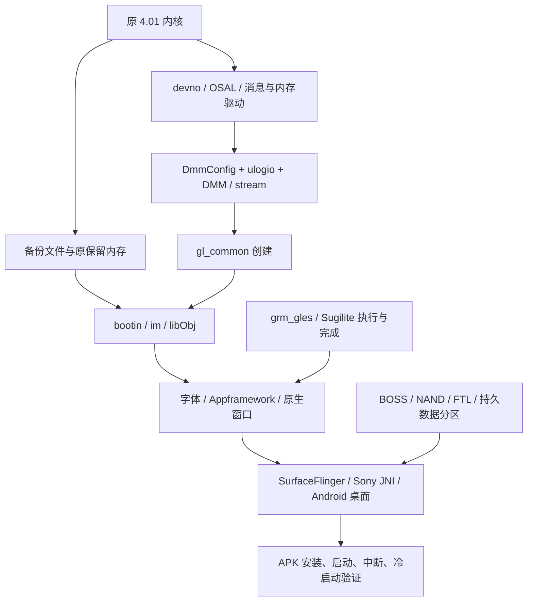

# 技术链路与当前断点

更新：2026-10-23。以下是自行整理的技术事实与契约，不包含原厂程序、反汇编清单或固件载荷。Rxx 对应[证据索引](EVIDENCE.md)。

## 1. 环境分层：三个“能运行”不能混用

| 层 | 当前实现 | 适合验证 |
|---|---|---|
| 主机检查与局部回放 | Java/Python/Node 检查、有限固件方法解释、故障注入 | 自有逻辑、已还原分支、资源契约 |
| 背面操作台 | 网页外壳，启动独立实验，展示日志 | 操作组织、实验状态、后续交互原型 |
| 原固件系统实验 | 定制 QEMU + 原 4.01 内核和部分用户态输入 | 已建模 CPU/外设及实际服务链行为 |

完整模拟器需要第三层真正驱动窗口、Android、数据存储和输入。前两层不能用来替代它。

硬件约束来源及未确定项：

| 项目 | 目前依据 | 限制 |
|---|---|---|
| CPU | OpenMemories 记录 CXD90014 为四 Cortex-A5；固定 QEMU 板型创建一个 Linux CPU | 不是完整四核/协处理域仿真；CPU 主频和执行时序未标定 |
| RAM | 4.01 kemco/板型对应 1 GiB 物理地址空间和多个保留区；一轮实际 Linux MemTotal 为 201516 kB | 1 GiB 不等于 Android 可自由使用内存；实验 initrd 影响余量 |
| 存储 | 原 partinf：设置约 13 MiB、Android 数据约 99.75 MiB，逻辑分区末端 438.75 MiB | 不等于确证物理闪存总容量；64 MiB 合成 NAND 只用于控制器测试 |
| 显示 | 原 WindowServer 日志为 640×480、双缓冲 | 不是对所有 LCD/EVF/录像格式的统一规格 |
| 系统 | 原文件为 Linux 3.0.27 系列、Android 4.1.2 / API16 / ARMv7 | 应用采用 API10 构建底线，不能把构建底线写成机身 Android 版本 |

CPU 百分比限速、TCI 耗时和 BogoMIPS 均不能直接换算真实录像帧率。容量、带宽、计算时间和调度时序需要分开校准。[硬件来源及具体约束](../VIRTUAL_CAMERA.md)。

## 2. 原生启动依赖

下图表示已追踪依赖，不宣称整个链已经运行成功，也不代替原启动脚本的精确先后关系：



关键定位顺序（R07–R14）：

1. Android 缺 OSAL 时，gralloc 路径有实际空指针故障，消息分配返回 -9。补原模块后变为等待 Sony 窗口连接。
2. 原生核心创建 `gl_common` 时，缺 MA 回调得到 -1020；补回调后消息发送可返回 0，但下游创建仍返回 -9999。不能只读外层返回值。
3. DMM 依赖 `DmmConfig.bin` 和日志记录区；原 `filp_open` 对缺失 `/setting/ulogio.bin` 返回 -2。通过匹配暖启动数据恢复配置后，相关初始化正常推进。
4. 补原 stream、节点、字体后，窗口表面创建成为后续停点。原 GPU 驱动要求的上电读回值与空 MMIO 不符。
5. 有限控制模型使驱动加载，但任务完成仍未产生；上层窗口不能因此验收。

注意 `libObj.so` 内嵌的原生 DMP 代码与 Android 的独立 `libDMPAlloc.so` 是不同对象。共享名称和类似调用不自动证明函数体、内存池或实际运行阶段相同。最新 A6000 分配器比较针对 Android 共享库，不能替代原生启动断点。

## 3. Sugilite：已知提交和消费端，未知硬件完成端

已观察的首个提交为四组单值命令，每组 8 字节，共 32 字节（R13/R14/R20）：

| 命令 ID | 原调试信息名称 | 已核对数据或作用边界 |
|---|---|---|
| `0x116` | CU_DUMMY_READ_ADDR | 缓冲物理地址右移 4 位；不能据此推断实际读取宽度 |
| `0x117` | CU_DUMMY_READ_START | 尾部构造写 1；启动后的事务规则未闭合 |
| `0x44` | RAS_ITERATOR | 值取决于构造分支，不能统一硬编码 |
| `0x10` | SYS_FRONT_PORT0 | 包含 `0x12345678`；不是任意目标内存的完成标记 |

原 `rm_reg_kick_3d` 将描述项 +4 写入 MMIO 偏移 `0x1804`，再把 +8 写到 `0x1800`。现有观察器在提交后读取虚拟 RAM 并解析格式；没有执行指令副作用、DMA 写回、渲染或完成中断。

128 字节对象以 128 对齐分配，CPU 写入 64 个 `0xff00` 半字；符号是 `dmp_error_tex_buffer_id`，曾确认用于备用纹理和虚读引用。大小和初值都不是“GPU 应将它覆写成成功”的依据。

完成链应分段理解：

```text
软件构造 → 提交寄存器 → GPU 实际读取/处理/写回
                        [缺：事务结束、缓存/端口传播条件]
    → 状态位 / IRQ76 → 原 grm_gles 确认与唤醒
    → 用户库等待结果 → fence / 条件变量 / 引用与回调
```

原 `0xc0048203` ioctl 等待请求对应的 31、30 或 26 位；错误包装可以返回 0，上层随后重试。fence 状态 `0x30f2` 和条件广播是软件完成传播。`srm_hw_reset` 原函数的直接返回也不是已实现的硬件复位。

**最小执行模型缺的不是再加一个“完成”返回值，而是可以核对的硬件副作用与时序条件。** 最终必须证明写回内容可见、正确事件触发、原驱动消费，并且未完成或出错时不会误报成功。

## 4. A6000/RX100 V 对照的实用价值

R19 的原驱动对照确认共同中断消费者；R20 的整库与邻接接口对照得到：

| 对象 | A6000 3.21 | A7R II 4.01 | RX100 V 2.00 |
|---|---:|---:|---|
| libDMPSUGIRM.so 字节数 | 100076 | 113792 | 与 4.01 完全一致 |
| libEGL_dmp.so 字节数 | 191564 | 200628 | 与 4.01 完全一致 |
| libGLESv2_dmp.so 字节数 | 1214700 | 1448348 | 与 4.01 完全一致 |
| DMP 固定池，总大小/块大小 | 512/16、8192/256 | 前两项加 4096/128、2457600/1228800 | 邻接三库未提取 |

A6000 `mpool_new` 对块数商 ≤31 返回空；4.01 对商 >32 返回空。各自调用参数支持该差异，不能把 A6000 实现替换进需要两块大池的 4.01。池大小也不能据此直接命名为某分辨率或图像格式。

两者 ANativeWindow 的 dequeue/lock/queue/cancel 回调偏移分别为 `0x48/0x4c/0x50/0x5c`；gralloc lock/unlock 为 `0x88/0x8c`。两份 gralloc 都进入 `ws_hal_lock/unlock`，4.01 另有 `handle+0x14 == 0x158` 的早返回条件。R21 已确认它来自私有格式参数，具体像素布局仍未知。

CPU 地址转换后调用 `memcpy` 只能证明 CPU 拷贝路径；R21 进一步核查了映射属性和窗口锁定协议，仍未证明 GPU 完成。

分析工具也有边界：gralloc 混合 ARM/Thumb，曾出现整库默认反汇编把 Thumb 当 ARM 的问题；最终限定函数已按 ELF 标志重新解码。以后不能把默认整库输出直接当全部函数的正确指令。

## 4a. 内存映射与窗口锁定：R21 新增的可核对范围

可以把缓冲区理解成 CPU 和图形设备共用的一块工作区。确认地址、控制 CPU 缓存、获得窗口锁、完成 GPU 工作，是四件不同的事。

**实际映射。** 新的只读 QEMU 观察取得原生进程的映射表。128 字节对象与首个命令包都位于同一个 32 MiB 的 `/dev/stream` 共享映射中；按“映射物理起点 + 虚拟地址相对偏移”换算，与断点读取的物理地址一致。128 字节内容仍是 64 个 `0xff00`。这把前轮原生 `libObj` 的指针和实际映射连接起来；它不是把 Android 的同名 MA 库直接当成原生实现。

**缓存属性。** 原 `stream.ko` 清除页保护值的 `0x3c` 位，再向 `remap_pfn_range` 提供带 `0x40` 的保护值；本版官方内核对应 `L_PTE_MT_MASK` 和 `L_PTE_DIRTY`，清除后的内存类型为 uncached。原 `grm_ma.ko` 另有刷新/失效入口，分别把方向 1/2 交给 `___dma_single_cpu_to_dev`；官方定义分别为 TO_DEVICE/FROM_DEVICE。其存在不证明首个提交实际调用了该入口，也不证明 GPU 内部缓存排空或完成中断已产生。

**Android MA 的静态行为。** `libma` 的相关创建路径默认按物理范围选择 `/dev/stream`（`0x80000000–0xbfffffff`）或 `/dev/mem`（`0xc0000000–0xcfffffff`），以共享、可读写方式映射。默认打开标志是 `0x1002`，对应此版的 O_RDWR 与 O_DSYNC；不能把它写成完整 O_SYNC，也不能据此证明全部内存路径采用相同属性。

**窗口缓冲。** `libdihal` 通过消息队列 `0x017f04b0` 获取共享管理区，以 MA 直接映射 2064 字节：16 字节头加 32 个 64 字节记录。lock/unlock 根据记录所属 PID 分本进程和跨进程两条路径。前者由信号量保护锁持有者字段；后者发送命令 1/2，等待对应响应并检查命令号和结果。unlock 清除锁字段，不能等同于 queueBuffer、释放图像或 GPU fence 已完成。R22 已静态核实原生服务端的命令1/2，见下一节；更高层窗口队列仍待追踪。

**`0x158` 的修订。** 原 gralloc 注册的 alloc 回调从第 4 个参数取得 format，比较 `0x158` 后写入特殊描述符的 `+0x14`。AOSP 4.1.2 的 alloc 接口和 `0x100–0x1ff` 私有格式保留范围与之相符。因此已确认“它是私有格式选择”，尚不能命名其像素编码或用途。该特殊分支建立描述符后跳过通常的窗口分配路径，不能推广为其他缓冲也可以跳过窗口服务。[AOSP gralloc 接口](https://raw.githubusercontent.com/aosp-mirror/platform_hardware_libhardware/android-4.1.2_r1/include/hardware/gralloc.h)、[私有格式范围](https://raw.githubusercontent.com/aosp-mirror/platform_system_core/android-4.1.2_r1/include/system/graphics.h)。

本轮 45 项输入、指令、映射和保护核查通过；一次客体观察完成，检查时 IRQ76 计数仍为 0。QEMU 执行模型没有修改，窗口、Android 和 APK 没有新增验收。原生服务端的后续结论见 R22；实际提交路径的缓存调用见 R23 未完成记录，GPU 硬件完成条件仍单独待证。

## 4b. 原生缓冲服务：锁定回复不是 GPU 完成（R22）

沿 R21 的队列追到原生 `libObj`：`createBufferManager` 注册 `0x017f04b0` 同步回调，`hal_create` 创建 `BufferFuncThread`，线程读取共享管理区的请求队列并向记录对应的响应队列回复。原字符串、GOT 指针和实际分派表相互吻合。

命令 1 对应锁定：在信号量保护下检查 `0x1f00` 使用标志，不匹配返回 -22；匹配时返回缓冲偏移并写入请求 PID。命令 2 对应解锁：清除锁持有者字段。两个限定处理体只调用记录信号量包装，没有 GPU 完成等待或间接调用。结果 0 仅表示这项锁操作完成，不能推广到图形执行、画面显示或 buffer queue。

一次只读启动观察同时监视注册、线程创建、线程等待和首 GPU 提交。首个命中是 GPU 提交；截至该点，前三处均未命中。随后正常脱离观察，客体检查完成，IRQ76 仍为 0。该结果限定于本次启动和观察区间，不证明服务以后永远不会启动。

39 项原字节、分派、运行与保护核查通过。原生服务端的命令 1/2 已明确，但未运行验证这些处理请求；更高层 queue/cancel/fence 仍未闭合。当前首包停点的下一步应回到实际 cache 调用和 GPU 访存完成条件，不能通过修改解锁返回值推进启动。

## 4c. 首包提交与缓存观察边界

R23 在原生提交封装及等待入口记录到：`0x1804 ← 0xb9c64270`、`0x1800 ← 4`，随后 `0xc0048203` 等待 `0x80000000`。这与已知提交顺序相符，没有证明 GPU 实际完成。

MA cache 入口按候选模块基址 `0x3f294000` 加 `.text` 内偏移 `0x598` 设置观察；在当时调试上下文中读入口字节返回 `E14`，导致原核验断言失败。该错误不足以区分地址定位问题与调试映射问题，观察器结果保持失败。`cache_hits=[]` 不具备否定缓存调用的证明力，后续物理RAM读回也未执行。

必须先核实模块 `.text` 的实际运行地址及读取上下文，再统计命中；不能仅根据 `/proc/modules` 的基址推定函数地址已验证。客体最终检查退出0、IRQ76为0是另一个范围的观察，不能覆盖此失败。

## 4d. 缓存观察的修订与已验证范围

R24 用原系统的 sysfs 与 kallsyms 确认 `grm_ma .text=0x3f294000`、`ma_cache_ctl=0x3f294598`。原模块的函数偏移为 `.text+0x598`，在正常进入 `sys_ioctl` 的内核上下文后，读回的入口指令与原文件相符。R23 的地址候选得到验证。

同一次观察中，用户态 CPSR 为 `0x30` 时读该地址返回 `E14`，原程序正常进入内核、CPSR 为 `0x80000013` 后读取成功。固定 QEMU 的调试地址翻译使用当前 MMU 上下文，解释了为何不能用用户态读取失败判断模块缺失。页表切换与访问权限的各自贡献尚未单独测量。[固定 QEMU 地址翻译实现](https://github.com/ma1co/qemu/blob/1909382c0d3533051cead7fde70ca8e84807ee14/target/arm/helper.c)、[调试读取实现](https://github.com/ma1co/qemu/blob/1909382c0d3533051cead7fde70ca8e84807ee14/gdbstub.c)。

从本次Linux 主 CPU 启动到首个提交后的匹配 `sys_ioctl` 入口，已验证的 `ma_cache_ctl` 断点没有命中；这只覆盖该入口与该窗口。32 字节命令包和128字节对象均从物理 RAM 正确读回。不能将该结果扩展为所有缓存路径都无需维护，或真实 GPU 已经完成总线访问。

两轮客体检查完成，50项证据核查通过，IRQ76仍为0。R23失败记录保留，R24修正的是观察条件；原固件、QEMU模型及GPU完成要求没有改变。后续重点回到GPU事务结束、端口传播和中断生产条件。

## 5. BOSS、引导程序和存储

BOSS 是原存储链依赖的协处理侧。R15/R16 已确认主 CPU 侧：

| 位置/入口 | 已确认含义 | 未证明部分 |
|---|---|---|
| `mumin_devif_load` | 按 NAND 描述读入 SRAM，长度上限 0x4000，并保留设备信息 | 匹配载荷、原始放置与完整加载元数据 |
| SRAM `+0x3f00` | 13 个 32 位字，共 52 字节设备信息；暖启动快照中有匹配副本 | 不等于每台机器/所有介质的通用常量 |
| SRAM `+0x3f40` | 通信邮箱，含状态、操作编号、请求和结果相关物理地址 | 协处理程序如何执行完整存储语义 |
| 邮箱 `+0x0c/+0x10` | 10 KiB 请求工作区大小/物理地址 | `+0x10` 不是程序入口 |
| firm_reset | IRQ、复位、通知、等待与状态检查；要求 status=2 且检查等待结果 | 只写 status=2 不等于启动成功 |

原 nand 冷初始化路径没有调用上述 load；空虚拟介质和缺失预加载程序是独立问题。实际冷初始化曾记录超时及 -10003。普通写入路径还会依赖 BOSS，因此不能循环论证“用这个写入工具先启动缺失的 BOSS”。

loader 链（R18–R20）：更新器依据 `loader_sum/loader.sum` 选择动作；4.01 原 `loader_writer.sh` 有启用的 MD5 校验，依赖 `loader_mpt.tar`、normal/safe 两个 pformat 配置及备份输入。`safe_list.txt` 由 normal 阶段生成，用于传递块信息，不是缺失程序。外机 A7S III 的归档报告只能指引搜索，不能替本机构造配置。

### BOSS候选的来源核查

R25 对早期未分类命中作字节来源核对。两个暖启动片段的完整512字节上下文，与原 `framework-res.apk` 中 `resources.arsc` 的条目偏移数组分别匹配20处和2处；其中 `0x3f40` 是资源偏移。另一个 `framework.odex` 命中位于内嵌DEX的 `proto_id`，其 `shortyIdx=0x3f40` 指向 `ILZFL`。这些命中提供了数据格式解释，不能当作BOSS邮箱访问指令。[AOSP资源结构](https://raw.githubusercontent.com/aosp-mirror/platform_frameworks_base/android-4.1.2_r1/include/androidfw/ResourceTypes.h)、[AOSP DEX结构](https://raw.githubusercontent.com/aosp-mirror/platform_dalvik/android-4.1.2_r1/libdex/DexFile.h)。

另一暖启动片段和SA容器内部命中仍未分类，没有已验证的程序入口或加载关系。它们不支持执行实验，也不能据此证明BOSS绝不存在于固件中。26项来源/结构/保护核查通过；没有取得匹配BOSS程序或改变现有模型。

## 5a. A6000 BOSS原驱动对照与可评估的协议模型（R26）

首次取得A6000 3.21原`lld.ko`/`nand.ko`并与4.01逐段比较。两者均使用SRAM+0x3f00的52字节设备信息、+0x3f40邮箱、0..17共18类API和10KiB工作缓冲；load长度上限0x4000。冷初始化仍只调用init、get_device_info和firm_reset，没有因此取得程序载荷。reset必须等待后检查状态2，不能只设置状态；等待函数的实现仍有差异。

Linux原`nand`内可核对mount→EBM→VBM→PBM调用链。4.01 PBM另有calc/get_lib_version和高16位比较，A6000所查同名函数没有这两个调用。这是不能直接复用外机存储元数据的新依据；并不等于已经知道所有版本字段或所有旧数据都会失败。

由此可以评估另一条存储路线：保留原Linux驱动，实现BOSS通信端的状态与数据操作，以研究是否能不执行原BOSS程序。**尚未证明完整协议可恢复，也未接入模型。** 它必须正确实现读写、extra/ECC、坏块、结果详情、复位与完成通知，并通过原驱动挂载和跨进程持久性；不能以恒成功、填假版本或假中断代替。该路线若成立也只是明确范围的功能仿真，不是原ARM7与物理时序的等价证明。

新SA格式资料与4.01的`sa_bayes_tracker_edge.bin`外壳一致：版本4、0x200处描述、0x34描述版本和加和校验均吻合。内部0x151d0常量仍未解释，不能当BOSS载荷；另一WBI弱候选也保留。43项静态/保护核查通过，无客体、模型或原固件修改。

GPU没有同等级新增完成规则。普通运行日志、驱动或库相同、IRQ总计数不能代替逐命令事务与状态转换；原窗口/Android验收没有变化。

## 5b. BOSS操作、元数据与实际启动输入（R27）

18类API在两机原驱动中对应如下。带单块/块组的两条路径不能混成一个请求；无符号代码用实际BL落点核对，不按反汇编最近的符号名推断。

| 操作号 | 驱动中的用途 |
|---|---|
| 0 / 1 | ldec_read / ldec_write |
| 2 / 3 | 标记坏块组 / 单块 |
| 4 | 读取顶部页extra |
| 5 / 6 | 块组 / 单块内读页 |
| 7 | 读取单页extra |
| 8 / 9 | 块组 / 单块内写页 |
| 10 | 写单页extra |
| 11 / 12 | 擦除块组 / 单块 |
| 13 / 14 | 查找块组 / 单块最后写入页 |
| 15 | 读取页组extra |
| 16 / 17 | 调试原始页读 / 写 |

这只是用途和提交归属，不是完整载荷规范。操作12已核对16字节请求（一个物理指针及三个输入字）；操作7有28字节请求和独立8字节extra输出。不能把这个8字节输出直接当作整页物理OOB/ECC格式。普通读写还涉及SG、页数、extra及结果详情，尚未完整还原。

邮箱结果字段在+0x1c，详情数+0x20、详情指针+0x24、两个输出+0x28/+0x2c。两版CPU结果转换对257个静态输入一致，但默认分支会返回0；这证明单看0无法验证未知BOSS响应。该检查不是硬件执行或257种操作验收。

PBI还有实际布局变化：A6000运行时指针表步长60，56字节header从缓冲起始读取；4.01表步长72，缓冲首字为lib_version，header从+4读取。4.01原初始化函数会计算并写入版本，不能仅伪造匹配值跳过挂载检查。

两机set_devif_init_param从0xc0001500复制20字节参数与后续200字节配置，再调整指针和坏块计数。原get_initial_bad_pblks遍历16位表项，不靠BOSS操作重新取得这张表。两次受控启动读到旧合成参数的坏块表指针为ffffffff；在实验复位配置下，原init返回源为0，但该坏指针和计数6仍进入52字节SRAM信息。此项是合成fixture缺陷，尚未观察到它被实际遍历，也不把它当作本轮BOSS超时的已证实原因。

默认配置停在NAND复位等待；既有实验复位配置进入BOSS等待并超时，程序区前0x3f00字节仍全0。两配置分别记录，实验IRQ路由/初始mask没有被认定为Sony规范。五个原指令停点观察成功只说明观察完成。两轮分别在主机150/180秒上限终止，均未出现客体检查完成标记。76项静态检查和28项运行记录核查通过；首轮观察器的非法地址读取失败完整保留。GPU执行、窗口、Android和APK门槛未改变。

## 5c. 暖启动中的参数副本与原驱动回放（R28）

原nand的冷初始化（boot_mode=1）从0xc0000c00逐项读16位坏块号，以0xffff结束，上限768项；再依据已有坏块调整六个初值0–5，并追加到该表。两机原代码对应。这解释了空合成清单上原驱动生成的六条保留块，不能把它们解释为六个物理坏块。

4.01 WBI不直接保存这一段ESRAM，但保存了nand模块的参数副本。通过R16已核实的ARM页表定位.text=0x3f024000，核对完整99,488字节代码段中的88,184字节非重定位内容，差异为0；结合两个独立重定位指针定位.bss，恢复20字节init_param及200字节init_reg_param。它们来自本版保存状态，不是按A6000猜出的值。snapshot中的boot_mode和ibb_num为0，不能由此断言实际相机没有出厂坏块。

新实验保留旧合成初始坏块清单，将恢复的配置放在启动输入区，配置指针改为其实际启动RAM位置；原set_devif_init_param仍负责复制及重写指针/计数。五个只读停点证实：原代码追加0–5，坏块指针变为可读取的0xc0000c00，原lld生成的52字节设备信息与R16恢复值逐字节相同。未直接写入该52字节输出，未修改返回值或原断言。

两机还有42组配置字段到MMIO寄存器的直接传递对应，但这不等于每个寄存器的硬件效果都已建模。测试沿用两项实验复位属性，保留64MiB合成介质，只验证初始化输入链；未校准完整几何/ECC。原观察在BOSS等待入口完成后主动停止，全程16.44秒，BOSS程序区仍为零。53项检查通过，GPU/窗口/Android/APK门槛不变。

## 5d. NAND配置、ECC分代与BOSS页读写（R29）

R28恢复配置与原驱动42组写入对应：4096字节正文、224字节物理备用区、每块64页，planes寄存器为0而原getter加1。ECC_CORRECTION为0x00820010。原A6000与4.01的ReadPage均保存/恢复0xe0、0x1b0、0x6d0、0x6e0，证明这些配置需保持。原程序临时读引导数据时设0x6d0=3、0x6e0=0、0xe0=0x4001，读每页1536字节，再恢复；不能把此特殊读当常规4096字节页。

[Linux v6.12 Denali头](https://github.com/torvalds/linux/blob/v6.12/drivers/mtd/nand/raw/denali.h)将0x6d0/0x6e0命名为数据块数/元数据大小，与Sony初始化的4096>>9=8和固定8对应。普通Sony页读写对extra缓存按页数×8处理；因此逻辑extra与物理224字节备用区分层，不能简单修改镜像步长。低5位纠错强度16与原指令相符，高字段0x82在Sony中的精确含义仍未确认。

同一上游明确：status bit0在旧IP为ECC_TRANSACTION_DONE，在新IP为ECC_UNCOR_ERR；Sony PIO路径将bit0及0x650 bit7走错误分支，低7位作阈值比较，符合后一消费方式。不能因旧头称其“完成”就置位。[上游BCH公式](https://github.com/torvalds/linux/blob/v6.12/drivers/mtd/nand/raw/denali.c)对512/16给每步26字节，8步加8元数据为216字节，能装进224；这只是容量相容计算，不证明Sony码字排列、多项式、剩余字节或擦除检测。

DMA有独立64字节描述符，结果在+0x20的16位值：先等bit15，再根据bit14、bit1、bit10、bit11或bits9:4的纠错计数分类。4.01直接读的十项内部返回表是0、-131078、-10007、-10001、-131073、-131079、-131080、-131077、-131088、-10003；A6000对应条件指令一致。此表和R27的BOSS邮箱正数转换不是同一层，不能混用；写0x8000仍不证明数据已纠错。

BOSS页组读op5的请求区为72+8×SG条数，写op8为76+8×SG条数；4.01共同头为起始描述指针、页数、SG指针及extra指针。读的嵌套起始描述/SG头从+20/+64开始，写从+24/+68开始。SG条目是长度/地址对，提交前转物理地址；读在前后处理数据和extra缓存，写在提交前flush，返回后分别读取pout数量输出。未确定保留字段、每页extra/ECC内容和坏块/失败恢复继续unknown，这还不是可执行的完整BOSS模型。

运行对照：旧模型8.31秒观察中四配置均0；候选7.01秒观察中为1、0x820010、8、8，原BOSS程序区/邮箱仍空。两轮均使用最小shell实验initrd、原内核和原模块、合成snapshot介质、两项实验复位属性；主动停在BOSS等待入口，非Android启动。另两次观察器错误保留：错误成员导致E14，qtest地址缺前缀触发宿主解析断言；修正观察器后通过，未改断言。

模型只补四项配置保存，并增加可选strict-ecc：使能ECC的DMA/PIO读或pipeline读在接触数据/完成前明确终止。这是未建模边界检查，不是Sony错误响应。原有默认合成控制器测试保留；新严格研究启动显式开启。55项证据检查、六组控制器测试通过，旧配置测试按预期失败。默认UI未切换二进制，未新增原生挂载、窗口、Android或APK验收。

## 5e. 8字节extra、独立ECC状态与等待条件（R30）

两机原 `mumin_cmn_set_extra_data` 的56字节函数及重定位相同：清零8字节，写byte0和byte5。4.01无名窗口0x7eb0–0x7f2c与A6000的0x8130–0x81ac也完全相同，构造0x40类extra：byte0含类型和按参数置/清的bit2、bit1，bit0清；bytes1–2、3–4分别存两个参数的低16位且高字节在前；byte5为另一参数低8位；6–7在这条路径保持零。字段业务含义仍需消费者确认，不能擅自命名版本/块号，不能把软件布局当物理spare列地址。

`get_pagegp_extra_and_ecc_buff`在4.01取对象+0x60，A6000取+0x54，返回extra基址和基址+32的另一个指针。`read_extra_pagegroup`单项分支经BOSS op7取得extra后，把-131077映成状态2、-131078映成1，其他映成0，并继续检查实际返回值。**未匹配错误也会使该状态字节为0，状态0不能单独证明成功。** 组分支op15的44字节请求将extra与状态指针分别放+8/+0xc，extra缓存维护固定16字节，状态长度取自组字段。相关上层以8字节推进extra、1字节推进状态；这条路径的“ECC缓冲”不是BCH parity，组宽度和错误层次仍须分别验证。

恢复的4.01配置经原驱动写0x230（通用Denali名SPARE_AREA_SKIP_BYTES）为0、0x240为0xffff，而0x6e0元数据大小为8。A6000仅验证字段映射相同，没有A6000原机参数值证据。因此通用Denali跳过8字节BBM的raw交错布局不能直接套成Sony布局。512/16→26字节仍只有旁证/容量一致性，Sony多项式、位序、元数据保护、剩余字节与0x82高字段未确定。

原等待代码进一步确认：中断模式醒来后仍检查累计状态与请求掩码；轮询先读/清0x410并判bit3超时，再按需读0x720和检查掩码。DMA等待返回后，read_data仍失效64字节描述符缓存、等待+32处16位结果bit15并判错误和计数。通知、描述符完成、ECC正确与BOSS业务结果须分别核实，生产端时序仍未知。

新增[Linux v6.12 Cadence原实现](https://github.com/torvalds/linux/blob/v6.12/drivers/mtd/nand/raw/cadence-nand-controller.c)有相似complete15/fail14/erased11/timeout10/uncorrectable1，但纠错计数为bits9:2，Sony为9:4；flags在+20，Sony在+18；它定义32位status，Sony此路径消费16位。新版寄存器也不同，不能移植为Sony硬件事实。该实现还按控制器最大支持步长计算ECC字节数，不能仅从当前步长跨IP确定码字。

两机debug raw页读写只是BOSS op16/op17客户端，请求36+8×SG条数；原始传输仍在缺失的BOSS执行端，客户端没有补出BCH/物理重排。4.01仅在转换返回-10003时调用restore_raw，异常恢复设置不能冒充正常raw配置。公开索引未找到匹配载荷；剩余WBI1323局部文本在原libObj.so有命中，尚无格式/加载证明，继续未分类。

54项输入/静态对应/保护检查通过。未修改QEMU或固件，本轮新启动次数0；没有新执行依据可跨过既有BOSS等待。R29 strict-ecc保持，原生挂载、GPU、窗口、Android/APK均未新增验收。

## 5f. extra消费者与ECC结果不能简化为单个成功标志（R31）

以下字段用途仅适用于**0x40类**软件extra；不是NAND物理列布局，也不扩展到其他类型。

| 字段 | 从写入和消费代码核实的用途 |
|---|---|
| byte0高4位 | 0x40类型；挂载检查标签后解释逻辑块与序号 |
| byte0 bit0 | EBM读TU路径的有效性检查；置1走错误分支，正常构造清0 |
| byte0 bit1/2 | 按构造参数置/清；准确业务名称尚未查明 |
| bytes1–2 | 高字节在前的逻辑块号lblk，不是物理块号 |
| bytes3–4 | 高字节在前的块内LTU编号，批量展开时逐TU递增 |
| byte5 | 8位循环代次/序号，写回+1并限制到8位，挂载按上下文比较前后代 |
| bytes6–7 | 此构造路径为0，本轮未证明全局用途或永远无用 |

4.01元数据展开窗口0x6cb4–0x6d8c与A6000 0x6fa8–0x7080的216字节相同：每TU的多个extra副本使用相同编号，TU之间递增，最后恢复模板编号。4.01 write_ltus在0xacb0–0xacd0传入逻辑块与LTU编号，0xaf1c–0xaf28递增循环代次。mount在0x97b0附近匹配逻辑块、0x40和代次，0x98f0附近计算(current-candidate)&255并只在<=3时接受该候选；这不是任意8位序号的通用全序规则。A6000对应消费与生成指令已逐项核对。

独立WDS路径将8字节清零后写byte0=0xAA，检查时比较完整0xAA；不猜WDS缩写，也不能将该标记与0x40 bit0解释混同。

原日志字符串和分支使ECC命名得到直接证据：单页包装层将-131076（extra可纠正）和-131078（page可纠正）归一化成-131076并复制8字节；将-131075（extra不可纠正）和-131077（page不可纠正）归一化成-131075并清零8字节。特殊-131088分支填FF后返回0，不代表物理擦除/ECC已验证。其他错误必须按返回继续处理。

上层状态1是可纠正类别、2是不可纠正类别，**不是纠错位数**。批量top-extra包装会在四种ECC告警后返回0，由逐项状态继续表达坏项。因此“状态0可伴错误返回”和“批量返回0可含坏项”同时成立。挂载选择器还检查初始坏块列表、status<=1与extra[0]!=0，然后才复制可用项，后续格式检查仍需执行。4.01单页窗口0xd2f8–0xd64c、A6000 0xd904–0xdcbc；逐项选择核心分别0x108f8附近与0x112cc附近。两机日志前缀、寄存器分配不同，不用固定地址直接替代。

物理完成规则仍缺执行端证据。[Linux v6.12 Denali](https://github.com/torvalds/linux/blob/v6.12/drivers/mtd/nand/raw/denali.c)的软件纠错路径消费错误记录至LAST_ERR再等旧IP的ECC_TRANSACTION_DONE；简单DMA的page-program完成注释对应bank状态0x410 bit2。Sony所追路径是0x720 bit1的命令描述符完成，再检查描述符+32 bit15及ECC结果，不能把Linux另一通道的注释套过来。软件extra用途不补足BCH多项式、位序、物理交错、metadata保护或完成生产顺序。

[A6000上游新增差异](https://github.com/nicolvus/a6000-fw-decomp/compare/f4dc706262de807f6a9502cd5abc37af469747e0...76d15b79d5a401334974bda5abc55a4a33e2b736)为8提交/189文件，以拍摄链路与证据修订为主，没有新增匹配BOSS。差异中的bootloader词来自被删除的镜头BL解释，不能当NAND载荷线索。新函数名查询也未取得可验证程序；loader_mpt及pformat程序来源继续未明。

本轮39项静态检查通过，原模块与QEMU二进制保留。没有新模型执行规则可跨过BOSS等待，未重复相同阻断启动；原生挂载、GPU和Android/APK验收保持未通过。

## 5g. extra恢复标志、DMA参数来源与旧Spectra差异（R32）

**本轮进展在软件契约，物理执行仍未补齐。** 53项静态核查及5个CPU暂停的控制器用例通过；没有修改模型/固件，也没有新增固件启动或原生挂载成功。

### extra bit1/2的可证用途

4.01 `mumin_vbm_reconstruct_vbi`起于0x14a60，A6000起于0x15160。以下是原分支的功能描述，不冒充Sony枚举名，也不将标志单独解释为“写入完成”：

| 判定 | 实际行为与边界 |
|---|---|
| 块首extra为0x40类，bit2=0 | 该块已登记used，然后跳过这段块尾/UDB重建；不能说整个块未使用 |
| 块首bit2=1 | 读取由原几何字段算出的最后一个虚拟页extra，继续检查返回值、类型、标志与代次 |
| 块首bit1=1，块尾类型为0xF0且读取为0或extra可纠正 | 调用`mumin_vbi_set_etbs`；不是直接证明物理擦除成功 |
| 块尾类型不为0xF0、bit2=1，且非extra不可纠正 | 进入UDB候选比较/登记；仍受逻辑块、代次及已有候选等后续条件约束 |
| 块尾extra不可纠正、块首bit1=1 | 存在另一条UDB恢复候选分支；bit1不是单一成功标志 |

4.01关键指令：0x14bec测试块首bit2，0x14c9c取块首bit1，0x14ccc登记ETB，0x14d04组合块尾类型和bit2，0x14e20以后处理不可纠正分支。A6000分别在0x152f4、0x153b4、0x153e4、0x15424附近，分支语义逐项核实；日志前缀和地址不同。原日志将相关片段标为`mumin_vbm_s_reconstruct_udb_in_vbi`。尾部读取接受0和-131076，-131075走不可纠正分支，其他错误仍会传播。

0x40构造器仍是flagA为0置bit2、flagB为0置bit1；若参数非0则清对应位。部分写回调用传0/0，一般写入调用的flagA由几何/连续性条件产生，不能将两个参数简单命名成“有效/成功”。bit3在已查构造路径清零，尚无独立消费含义。

### 第6–7字节：排除一个假线索，保留未知

两机`nand.ko`显式`ldrb/ldrh/strb/strh [base,+6/+7]`各有4处：其中两处属于`mumin_setup_partition`，基址指向分区记录，并非8字节extra；另两处属于EBM错误调试打印，输出全部8字节。extra本身在已查构造器中清零、随8字节整体复制；没有查到这两字节参与独立比较/计算。

这是**限定范围的操作数与数据来源核对**，不是全程序别名分析，不能排除变址访问、整字比较或缺失BOSS内部使用。因此第6–7字节继续unknown，不能据此造校验码、BCH parity或“保留字节”规格。

### DMA输入单位已追到原构造代码

以下偏移全部为十六进制，相对`boss_hw_nandc_read_data`的输入结构：

| 输入 | 原驱动构造/描述符结果 |
|---|---|
| +0x10 | 整页分支=3；页内分段=5 |
| +0x14 | 这两条调用路径设0x40；最终描述符+0x12的16位flags加0x100及mode<<12，分别为0x3140/0x5140 |
| +0x18 | mode3为本次整页数；mode5为`本次扇区数 OR (页内起始扇区<<4)`；与0x2000组合写描述符+0x10 |
| +0x20 / +0x24 | 正文/extra物理指针，分别写描述符+0x18/+0x38 |

4.01构造核心0x41bc–0x4244与A6000 0x3434–0x34bc的136字节相同。扇区数来自SG字节数右移9，缓存字节数/指针推进左移9；每页extra推进8字节。mode5若尚未读到页尾，将extra指针指向临时缓冲；到页尾才使用调用者的extra位置。它不是“每读一个512字节扇区都产出一组有效extra”。原代码在mode5提交前发送MAP10命令0x47，结束后恢复0x42；这些是访问模式操作，不是物理列偏移。

上述证据确定逻辑读请求的单位与缓冲区用途，仍不能推出物理spare中的BCH位置、bit序、metadata保护范围。

### 新增旧Spectra参照：相同位名不等于相同ABI

[Linux v2.6.37 Spectra寄存器](https://github.com/torvalds/linux/blob/v2.6.37/drivers/staging/spectra/nand_regs.h)将0x720 bit1命名为通道0描述符完成，与Sony等待0x720掩码2相合。[提交代码](https://github.com/torvalds/linux/blob/v2.6.37/drivers/staging/spectra/lld_cdma.c)明确注释flags bit8请求中断、bit9继续链；Sony这两种flags也都是bit8=1、bit9=0。这提供中断请求含义的旁证，尚不是Sony写回与IRQ的物理时序规范。

差异不能忽略：[旧描述符](https://github.com/torvalds/linux/blob/v2.6.37/drivers/staging/spectra/lld_cdma.h)将32位指针拆成两个各占32位的16位部分，flags在+0x1c、status在+0x24；Sony原驱动flags为+0x12的16位，status为+0x20的16位，另有独立extra指针。两者都使用status bit15完成、bit14失败，但结构不能复制。

[旧ECC与格式转换代码](https://github.com/torvalds/linux/blob/v2.6.37/drivers/staging/spectra/lld_nand.c)还给出不同填充公式：strength16算出26后因偶数加2，即28字节/步；8步已占224字节，再加Sony8字节metadata为232，大于恢复出的224字节spare。新旧IP都叫Denali不足以决定布局。旧代码可作不兼容反例，不能移植为Sony码字生成器。

Sony原流程仍先等待0x720 bit1，再失效描述符缓存、检查+0x20 bit15和ECC结果。新的参照没有补足“实际完成数据/ECC写回后怎样产生状态与IRQ”的生产端规则；禁止仅凭请求中断位就报告成功。

### 实际验证与BOSS搜索

本轮使用固定R29实验QEMU、CPU全程暂停：整页两页、页内起始3读2扇区、起始7读1扇区，3项均核对正文、extra及缓冲尾部哨兵；这些只验证ECC关闭时的**合成逻辑介质**。另外两项加载恢复的ECC配置，mode3/5均以“ECC execution is not modeled”明确终止主机模型。该终止是未实现边界，不是Sony硬件错误码。五项均符合预期，256.5KiB测试介质未变化并已删除。

定向公开检索ARM7/BOSS、boot1及loader_mpt/pformat仍未取得可验证BOSS程序；未重复抓取无变化仓库或整包固件。新增5份上游文本共127739字节，无新依赖、大文件下载或相机操作。匹配BOSS候选数仍0，不能据此声称BOSS不存在。

## 6. 录像前反挤压：结构存在，连续桥接尚缺

R03 从原配置表确认的对象链：

```text
SCALAR_MOVIE_REC：Camera → Scalar(出3) → Effect(入1/出1)
                                            → MovieRecorder(YC入0)
默认物理请求：SFR(出no1) → VEF(入/出no2) → MC(入no0)
```

MC 默认目标为 `0x005700f9`，存在 TCUB 前级和效果条件分支；这是特定模式的静态配置，不是所有 4K/AVCHD/XAVC 模式的运行轨迹。MC 接收可进入 `McAvcEncVfm::SetYcPinData`，附近还有其他模式分支。

独立宽高缩放链为 SCALE → resizeTrim → ObjScalar `0x3017` → HAPI `0x201` → SdfApiResizeTrim → SDF 队列 `0x0056000f` 的命令 3。它有票据、标准 YC 输出、请求和完成处理，不能等同于 SA/DSP 插件，也没有证明某颗硬件的具体插值实现。

逐帧桥接必须补齐：

1. 录像输入帧如何取得可合法消费的票据；借用、共享与转移所有权分开。
2. SDF 完成后怎样取得输出 YC 描述及其中的像素 UnitHandle；票据不是裸指针。
3. 原帧、缩放输出、编码器持有期的释放规则。所查 MC 的 ReleasePic 后还可能延迟到 Vsync 计数归零。
4. 帧身份、传输时序、顺序、停止排空、错误清理和背压；现有 SDF 后处理没有建立完整录像时序继承。
5. 格式/步长/对齐/画布/缓存一致性及资源争用。4 个 SDF 槽和 72 个 MC 记录项不等于 4 个执行引擎或 72 帧像素容量。

30 fps 的平均吞吐预算约为每帧 33.3 ms，60 fps 约 16.7 ms；流水线延迟可以更长，但不能持续积压。现无足够执行、带宽和回收时延测量，1080p/4K 的可持续性能均为未知。虚拟机速度也不能代替该测量。

机背取景的 CameraSequence/自绘候选与录像前处理应单独验收；仅在网页、位图或预览层显示拉伸，不能证明录制文件中的画面已反挤压。
