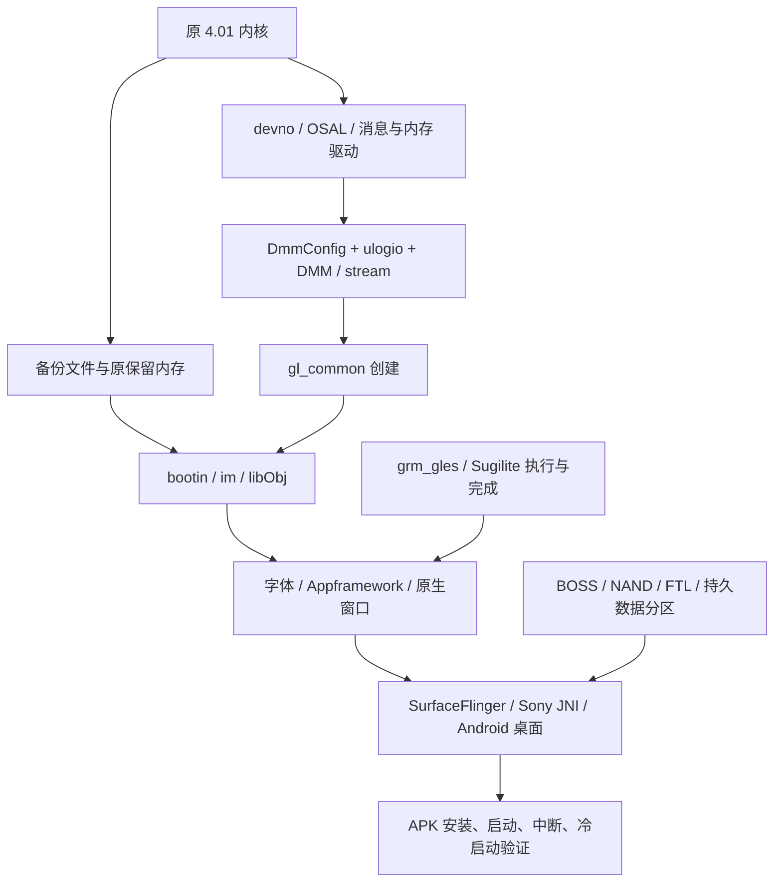

# 技术链路与当前断点

更新：2026-10-23。以下是自行整理的技术事实与契约，不包含原厂程序、反汇编清单或固件载荷。Rxx 对应[证据索引](EVIDENCE.md)。

## 1. 环境分层：三个“能运行”不能混用

| 层 | 当前实现 | 适合验证 |
|---|---|---|
| 主机检查与局部回放 | Java/Python/Node 检查、有限固件方法解释、故障注入 | 自有逻辑、已还原分支、资源契约 |
| 背面操作台 | 网页外壳，启动独立实验，展示日志 | 操作组织、实验状态、后续交互原型 |
| 原固件系统实验 | 定制 QEMU + 原 4.01 内核和部分用户态输入 | 已建模 CPU/外设及实际服务链行为 |

完整模拟器需要第三层真正驱动窗口、Android、数据存储和输入。前两层不能用来替代它。

硬件约束来源及未确定项：

| 项目 | 目前依据 | 限制 |
|---|---|---|
| CPU | OpenMemories 记录 CXD90014 为四 Cortex-A5；固定 QEMU 板型创建一个 Linux CPU | 不是完整四核/协处理域仿真；CPU 主频和执行时序未标定 |
| RAM | 4.01 kemco/板型对应 1 GiB 物理地址空间和多个保留区；一轮实际 Linux MemTotal 为 201516 kB | 1 GiB 不等于 Android 可自由使用内存；实验 initrd 影响余量 |
| 存储 | 原 partinf：设置约 13 MiB、Android 数据约 99.75 MiB，逻辑分区末端 438.75 MiB | 不等于确证物理闪存总容量；64 MiB 合成 NAND 只用于控制器测试 |
| 显示 | 原 WindowServer 日志为 640×480、双缓冲 | 不是对所有 LCD/EVF/录像格式的统一规格 |
| 系统 | 原文件为 Linux 3.0.27 系列、Android 4.1.2 / API16 / ARMv7 | 应用采用 API10 构建底线，不能把构建底线写成机身 Android 版本 |

CPU 百分比限速、TCI 耗时和 BogoMIPS 均不能直接换算真实录像帧率。容量、带宽、计算时间和调度时序需要分开校准。[硬件来源及具体约束](../VIRTUAL_CAMERA.md)。

## 2. 原生启动依赖

下图表示已追踪依赖，不宣称整个链已经运行成功，也不代替原启动脚本的精确先后关系：



关键定位顺序（R07–R14）：

1. Android 缺 OSAL 时，gralloc 路径有实际空指针故障，消息分配返回 -9。补原模块后变为等待 Sony 窗口连接。
2. 原生核心创建 `gl_common` 时，缺 MA 回调得到 -1020；补回调后消息发送可返回 0，但下游创建仍返回 -9999。不能只读外层返回值。
3. DMM 依赖 `DmmConfig.bin` 和日志记录区；原 `filp_open` 对缺失 `/setting/ulogio.bin` 返回 -2。通过匹配暖启动数据恢复配置后，相关初始化正常推进。
4. 补原 stream、节点、字体后，窗口表面创建成为后续停点。原 GPU 驱动要求的上电读回值与空 MMIO 不符。
5. 有限控制模型使驱动加载，但任务完成仍未产生；上层窗口不能因此验收。

注意 `libObj.so` 内嵌的原生 DMP 代码与 Android 的独立 `libDMPAlloc.so` 是不同对象。共享名称和类似调用不自动证明函数体、内存池或实际运行阶段相同。最新 A6000 分配器比较针对 Android 共享库，不能替代原生启动断点。

## 3. Sugilite：已知提交和消费端，未知硬件完成端

已观察的首个提交为四组单值命令，每组 8 字节，共 32 字节（R13/R14/R20）：

| 命令 ID | 原调试信息名称 | 已核对数据或作用边界 |
|---|---|---|
| `0x116` | CU_DUMMY_READ_ADDR | 缓冲物理地址右移 4 位；不能据此推断实际读取宽度 |
| `0x117` | CU_DUMMY_READ_START | 尾部构造写 1；启动后的事务规则未闭合 |
| `0x44` | RAS_ITERATOR | 值取决于构造分支，不能统一硬编码 |
| `0x10` | SYS_FRONT_PORT0 | 包含 `0x12345678`；不是任意目标内存的完成标记 |

原 `rm_reg_kick_3d` 将描述项 +4 写入 MMIO 偏移 `0x1804`，再把 +8 写到 `0x1800`。现有观察器在提交后读取虚拟 RAM 并解析格式；没有执行指令副作用、DMA 写回、渲染或完成中断。

128 字节对象以 128 对齐分配，CPU 写入 64 个 `0xff00` 半字；符号是 `dmp_error_tex_buffer_id`，曾确认用于备用纹理和虚读引用。大小和初值都不是“GPU 应将它覆写成成功”的依据。

完成链应分段理解：

```text
软件构造 → 提交寄存器 → GPU 实际读取/处理/写回
                        [缺：事务结束、缓存/端口传播条件]
    → 状态位 / IRQ76 → 原 grm_gles 确认与唤醒
    → 用户库等待结果 → fence / 条件变量 / 引用与回调
```

原 `0xc0048203` ioctl 等待请求对应的 31、30 或 26 位；错误包装可以返回 0，上层随后重试。fence 状态 `0x30f2` 和条件广播是软件完成传播。`srm_hw_reset` 原函数的直接返回也不是已实现的硬件复位。

**最小执行模型缺的不是再加一个“完成”返回值，而是可以核对的硬件副作用与时序条件。** 最终必须证明写回内容可见、正确事件触发、原驱动消费，并且未完成或出错时不会误报成功。

## 4. A6000/RX100 V 对照的实用价值

R19 的原驱动对照确认共同中断消费者；R20 的整库与邻接接口对照得到：

| 对象 | A6000 3.21 | A7R II 4.01 | RX100 V 2.00 |
|---|---:|---:|---|
| libDMPSUGIRM.so 字节数 | 100076 | 113792 | 与 4.01 完全一致 |
| libEGL_dmp.so 字节数 | 191564 | 200628 | 与 4.01 完全一致 |
| libGLESv2_dmp.so 字节数 | 1214700 | 1448348 | 与 4.01 完全一致 |
| DMP 固定池，总大小/块大小 | 512/16、8192/256 | 前两项加 4096/128、2457600/1228800 | 邻接三库未提取 |

A6000 `mpool_new` 对块数商 ≤31 返回空；4.01 对商 >32 返回空。各自调用参数支持该差异，不能把 A6000 实现替换进需要两块大池的 4.01。池大小也不能据此直接命名为某分辨率或图像格式。

两者 ANativeWindow 的 dequeue/lock/queue/cancel 回调偏移分别为 `0x48/0x4c/0x50/0x5c`；gralloc lock/unlock 为 `0x88/0x8c`。两份 gralloc 都进入 `ws_hal_lock/unlock`，4.01 另有 `handle+0x14 == 0x158` 的早返回条件。R21 已确认它来自私有格式参数，具体像素布局仍未知。

CPU 地址转换后调用 `memcpy` 只能证明 CPU 拷贝路径；R21 进一步核查了映射属性和窗口锁定协议，仍未证明 GPU 完成。

分析工具也有边界：gralloc 混合 ARM/Thumb，曾出现整库默认反汇编把 Thumb 当 ARM 的问题；最终限定函数已按 ELF 标志重新解码。以后不能把默认整库输出直接当全部函数的正确指令。

## 4a. 内存映射与窗口锁定：R21 新增的可核对范围

可以把缓冲区理解成 CPU 和图形设备共用的一块工作区。确认地址、控制 CPU 缓存、获得窗口锁、完成 GPU 工作，是四件不同的事。

**实际映射。** 新的只读 QEMU 观察取得原生进程的映射表。128 字节对象与首个命令包都位于同一个 32 MiB 的 `/dev/stream` 共享映射中；按“映射物理起点 + 虚拟地址相对偏移”换算，与断点读取的物理地址一致。128 字节内容仍是 64 个 `0xff00`。这把前轮原生 `libObj` 的指针和实际映射连接起来；它不是把 Android 的同名 MA 库直接当成原生实现。

**缓存属性。** 原 `stream.ko` 清除页保护值的 `0x3c` 位，再向 `remap_pfn_range` 提供带 `0x40` 的保护值；本版官方内核对应 `L_PTE_MT_MASK` 和 `L_PTE_DIRTY`，清除后的内存类型为 uncached。原 `grm_ma.ko` 另有刷新/失效入口，分别把方向 1/2 交给 `___dma_single_cpu_to_dev`；官方定义分别为 TO_DEVICE/FROM_DEVICE。其存在不证明首个提交实际调用了该入口，也不证明 GPU 内部缓存排空或完成中断已产生。

**Android MA 的静态行为。** `libma` 的相关创建路径默认按物理范围选择 `/dev/stream`（`0x80000000–0xbfffffff`）或 `/dev/mem`（`0xc0000000–0xcfffffff`），以共享、可读写方式映射。默认打开标志是 `0x1002`，对应此版的 O_RDWR 与 O_DSYNC；不能把它写成完整 O_SYNC，也不能据此证明全部内存路径采用相同属性。

**窗口缓冲。** `libdihal` 通过消息队列 `0x017f04b0` 获取共享管理区，以 MA 直接映射 2064 字节：16 字节头加 32 个 64 字节记录。lock/unlock 根据记录所属 PID 分本进程和跨进程两条路径。前者由信号量保护锁持有者字段；后者发送命令 1/2，等待对应响应并检查命令号和结果。unlock 清除锁字段，不能等同于 queueBuffer、释放图像或 GPU fence 已完成。R22 已静态核实原生服务端的命令1/2，见下一节；更高层窗口队列仍待追踪。

**`0x158` 的修订。** 原 gralloc 注册的 alloc 回调从第 4 个参数取得 format，比较 `0x158` 后写入特殊描述符的 `+0x14`。AOSP 4.1.2 的 alloc 接口和 `0x100–0x1ff` 私有格式保留范围与之相符。因此已确认“它是私有格式选择”，尚不能命名其像素编码或用途。该特殊分支建立描述符后跳过通常的窗口分配路径，不能推广为其他缓冲也可以跳过窗口服务。[AOSP gralloc 接口](https://raw.githubusercontent.com/aosp-mirror/platform_hardware_libhardware/android-4.1.2_r1/include/hardware/gralloc.h)、[私有格式范围](https://raw.githubusercontent.com/aosp-mirror/platform_system_core/android-4.1.2_r1/include/system/graphics.h)。

本轮 45 项输入、指令、映射和保护核查通过；一次客体观察完成，检查时 IRQ76 计数仍为 0。QEMU 执行模型没有修改，窗口、Android 和 APK 没有新增验收。原生服务端的后续结论见 R22；实际提交路径的缓存调用见 R23 未完成记录，GPU 硬件完成条件仍单独待证。

## 4b. 原生缓冲服务：锁定回复不是 GPU 完成（R22）

沿 R21 的队列追到原生 `libObj`：`createBufferManager` 注册 `0x017f04b0` 同步回调，`hal_create` 创建 `BufferFuncThread`，线程读取共享管理区的请求队列并向记录对应的响应队列回复。原字符串、GOT 指针和实际分派表相互吻合。

命令 1 对应锁定：在信号量保护下检查 `0x1f00` 使用标志，不匹配返回 -22；匹配时返回缓冲偏移并写入请求 PID。命令 2 对应解锁：清除锁持有者字段。两个限定处理体只调用记录信号量包装，没有 GPU 完成等待或间接调用。结果 0 仅表示这项锁操作完成，不能推广到图形执行、画面显示或 buffer queue。

一次只读启动观察同时监视注册、线程创建、线程等待和首 GPU 提交。首个命中是 GPU 提交；截至该点，前三处均未命中。随后正常脱离观察，客体检查完成，IRQ76 仍为 0。该结果限定于本次启动和观察区间，不证明服务以后永远不会启动。

39 项原字节、分派、运行与保护核查通过。原生服务端的命令 1/2 已明确，但未运行验证这些处理请求；更高层 queue/cancel/fence 仍未闭合。当前首包停点的下一步应回到实际 cache 调用和 GPU 访存完成条件，不能通过修改解锁返回值推进启动。

## 4c. 首包提交与缓存观察边界

R23 在原生提交封装及等待入口记录到：`0x1804 ← 0xb9c64270`、`0x1800 ← 4`，随后 `0xc0048203` 等待 `0x80000000`。这与已知提交顺序相符，没有证明 GPU 实际完成。

MA cache 入口按候选模块基址 `0x3f294000` 加 `.text` 内偏移 `0x598` 设置观察；在当时调试上下文中读入口字节返回 `E14`，导致原核验断言失败。该错误不足以区分地址定位问题与调试映射问题，观察器结果保持失败。`cache_hits=[]` 不具备否定缓存调用的证明力，后续物理RAM读回也未执行。

必须先核实模块 `.text` 的实际运行地址及读取上下文，再统计命中；不能仅根据 `/proc/modules` 的基址推定函数地址已验证。客体最终检查退出0、IRQ76为0是另一个范围的观察，不能覆盖此失败。

## 4d. 缓存观察的修订与已验证范围

R24 用原系统的 sysfs 与 kallsyms 确认 `grm_ma .text=0x3f294000`、`ma_cache_ctl=0x3f294598`。原模块的函数偏移为 `.text+0x598`，在正常进入 `sys_ioctl` 的内核上下文后，读回的入口指令与原文件相符。R23 的地址候选得到验证。

同一次观察中，用户态 CPSR 为 `0x30` 时读该地址返回 `E14`，原程序正常进入内核、CPSR 为 `0x80000013` 后读取成功。固定 QEMU 的调试地址翻译使用当前 MMU 上下文，解释了为何不能用用户态读取失败判断模块缺失。页表切换与访问权限的各自贡献尚未单独测量。[固定 QEMU 地址翻译实现](https://github.com/ma1co/qemu/blob/1909382c0d3533051cead7fde70ca8e84807ee14/target/arm/helper.c)、[调试读取实现](https://github.com/ma1co/qemu/blob/1909382c0d3533051cead7fde70ca8e84807ee14/gdbstub.c)。

从本次Linux 主 CPU 启动到首个提交后的匹配 `sys_ioctl` 入口，已验证的 `ma_cache_ctl` 断点没有命中；这只覆盖该入口与该窗口。32 字节命令包和128字节对象均从物理 RAM 正确读回。不能将该结果扩展为所有缓存路径都无需维护，或真实 GPU 已经完成总线访问。

两轮客体检查完成，50项证据核查通过，IRQ76仍为0。R23失败记录保留，R24修正的是观察条件；原固件、QEMU模型及GPU完成要求没有改变。后续重点回到GPU事务结束、端口传播和中断生产条件。

## 5. BOSS、引导程序和存储

BOSS 是原存储链依赖的协处理侧。R15/R16 已确认主 CPU 侧：

| 位置/入口 | 已确认含义 | 未证明部分 |
|---|---|---|
| `mumin_devif_load` | 按 NAND 描述读入 SRAM，长度上限 0x4000，并保留设备信息 | 匹配载荷、原始放置与完整加载元数据 |
| SRAM `+0x3f00` | 13 个 32 位字，共 52 字节设备信息；暖启动快照中有匹配副本 | 不等于每台机器/所有介质的通用常量 |
| SRAM `+0x3f40` | 通信邮箱，含状态、操作编号、请求和结果相关物理地址 | 协处理程序如何执行完整存储语义 |
| 邮箱 `+0x0c/+0x10` | 10 KiB 请求工作区大小/物理地址 | `+0x10` 不是程序入口 |
| firm_reset | IRQ、复位、通知、等待与状态检查；要求 status=2 且检查等待结果 | 只写 status=2 不等于启动成功 |

原 nand 冷初始化路径没有调用上述 load；空虚拟介质和缺失预加载程序是独立问题。实际冷初始化曾记录超时及 -10003。普通写入路径还会依赖 BOSS，因此不能循环论证“用这个写入工具先启动缺失的 BOSS”。

loader 链（R18–R20）：更新器依据 `loader_sum/loader.sum` 选择动作；4.01 原 `loader_writer.sh` 有启用的 MD5 校验，依赖 `loader_mpt.tar`、normal/safe 两个 pformat 配置及备份输入。`safe_list.txt` 由 normal 阶段生成，用于传递块信息，不是缺失程序。外机 A7S III 的归档报告只能指引搜索，不能替本机构造配置。

### BOSS候选的来源核查

R25 对早期未分类命中作字节来源核对。两个暖启动片段的完整512字节上下文，与原 `framework-res.apk` 中 `resources.arsc` 的条目偏移数组分别匹配20处和2处；其中 `0x3f40` 是资源偏移。另一个 `framework.odex` 命中位于内嵌DEX的 `proto_id`，其 `shortyIdx=0x3f40` 指向 `ILZFL`。这些命中提供了数据格式解释，不能当作BOSS邮箱访问指令。[AOSP资源结构](https://raw.githubusercontent.com/aosp-mirror/platform_frameworks_base/android-4.1.2_r1/include/androidfw/ResourceTypes.h)、[AOSP DEX结构](https://raw.githubusercontent.com/aosp-mirror/platform_dalvik/android-4.1.2_r1/libdex/DexFile.h)。

另一暖启动片段和SA容器内部命中仍未分类，没有已验证的程序入口或加载关系。它们不支持执行实验，也不能据此证明BOSS绝不存在于固件中。26项来源/结构/保护核查通过；没有取得匹配BOSS程序或改变现有模型。

## 5a. A6000 BOSS原驱动对照与可评估的协议模型（R26）

首次取得A6000 3.21原`lld.ko`/`nand.ko`并与4.01逐段比较。两者均使用SRAM+0x3f00的52字节设备信息、+0x3f40邮箱、0..17共18类API和10KiB工作缓冲；load长度上限0x4000。冷初始化仍只调用init、get_device_info和firm_reset，没有因此取得程序载荷。reset必须等待后检查状态2，不能只设置状态；等待函数的实现仍有差异。

Linux原`nand`内可核对mount→EBM→VBM→PBM调用链。4.01 PBM另有calc/get_lib_version和高16位比较，A6000所查同名函数没有这两个调用。这是不能直接复用外机存储元数据的新依据；并不等于已经知道所有版本字段或所有旧数据都会失败。

由此可以评估另一条存储路线：保留原Linux驱动，实现BOSS通信端的状态与数据操作，以研究是否能不执行原BOSS程序。**尚未证明完整协议可恢复，也未接入模型。** 它必须正确实现读写、extra/ECC、坏块、结果详情、复位与完成通知，并通过原驱动挂载和跨进程持久性；不能以恒成功、填假版本或假中断代替。该路线若成立也只是明确范围的功能仿真，不是原ARM7与物理时序的等价证明。

新SA格式资料与4.01的`sa_bayes_tracker_edge.bin`外壳一致：版本4、0x200处描述、0x34描述版本和加和校验均吻合。内部0x151d0常量仍未解释，不能当BOSS载荷；另一WBI弱候选也保留。43项静态/保护核查通过，无客体、模型或原固件修改。

GPU没有同等级新增完成规则。普通运行日志、驱动或库相同、IRQ总计数不能代替逐命令事务与状态转换；原窗口/Android验收没有变化。

## 5b. BOSS操作、元数据与实际启动输入（R27）

18类API在两机原驱动中对应如下。带单块/块组的两条路径不能混成一个请求；无符号代码用实际BL落点核对，不按反汇编最近的符号名推断。

| 操作号 | 驱动中的用途 |
|---|---|
| 0 / 1 | ldec_read / ldec_write |
| 2 / 3 | 标记坏块组 / 单块 |
| 4 | 读取顶部页extra |
| 5 / 6 | 块组 / 单块内读页 |
| 7 | 读取单页extra |
| 8 / 9 | 块组 / 单块内写页 |
| 10 | 写单页extra |
| 11 / 12 | 擦除块组 / 单块 |
| 13 / 14 | 查找块组 / 单块最后写入页 |
| 15 | 读取页组extra |
| 16 / 17 | 调试原始页读 / 写 |

这只是用途和提交归属，不是完整载荷规范。操作12已核对16字节请求（一个物理指针及三个输入字）；操作7有28字节请求和独立8字节extra输出。不能把这个8字节输出直接当作整页物理OOB/ECC格式。普通读写还涉及SG、页数、extra及结果详情，尚未完整还原。

邮箱结果字段在+0x1c，详情数+0x20、详情指针+0x24、两个输出+0x28/+0x2c。两版CPU结果转换对257个静态输入一致，但默认分支会返回0；这证明单看0无法验证未知BOSS响应。该检查不是硬件执行或257种操作验收。

PBI还有实际布局变化：A6000运行时指针表步长60，56字节header从缓冲起始读取；4.01表步长72，缓冲首字为lib_version，header从+4读取。4.01原初始化函数会计算并写入版本，不能仅伪造匹配值跳过挂载检查。

两机set_devif_init_param从0xc0001500复制20字节参数与后续200字节配置，再调整指针和坏块计数。原get_initial_bad_pblks遍历16位表项，不靠BOSS操作重新取得这张表。两次受控启动读到旧合成参数的坏块表指针为ffffffff；在实验复位配置下，原init返回源为0，但该坏指针和计数6仍进入52字节SRAM信息。此项是合成fixture缺陷，尚未观察到它被实际遍历，也不把它当作本轮BOSS超时的已证实原因。

默认配置停在NAND复位等待；既有实验复位配置进入BOSS等待并超时，程序区前0x3f00字节仍全0。两配置分别记录，实验IRQ路由/初始mask没有被认定为Sony规范。五个原指令停点观察成功只说明观察完成。两轮分别在主机150/180秒上限终止，均未出现客体检查完成标记。76项静态检查和28项运行记录核查通过；首轮观察器的非法地址读取失败完整保留。GPU执行、窗口、Android和APK门槛未改变。

## 6. 录像前反挤压：结构存在，连续桥接尚缺

R03 从原配置表确认的对象链：

```text
SCALAR_MOVIE_REC：Camera → Scalar(出3) → Effect(入1/出1)
                                            → MovieRecorder(YC入0)
默认物理请求：SFR(出no1) → VEF(入/出no2) → MC(入no0)
```

MC 默认目标为 `0x005700f9`，存在 TCUB 前级和效果条件分支；这是特定模式的静态配置，不是所有 4K/AVCHD/XAVC 模式的运行轨迹。MC 接收可进入 `McAvcEncVfm::SetYcPinData`，附近还有其他模式分支。

独立宽高缩放链为 SCALE → resizeTrim → ObjScalar `0x3017` → HAPI `0x201` → SdfApiResizeTrim → SDF 队列 `0x0056000f` 的命令 3。它有票据、标准 YC 输出、请求和完成处理，不能等同于 SA/DSP 插件，也没有证明某颗硬件的具体插值实现。

逐帧桥接必须补齐：

1. 录像输入帧如何取得可合法消费的票据；借用、共享与转移所有权分开。
2. SDF 完成后怎样取得输出 YC 描述及其中的像素 UnitHandle；票据不是裸指针。
3. 原帧、缩放输出、编码器持有期的释放规则。所查 MC 的 ReleasePic 后还可能延迟到 Vsync 计数归零。
4. 帧身份、传输时序、顺序、停止排空、错误清理和背压；现有 SDF 后处理没有建立完整录像时序继承。
5. 格式/步长/对齐/画布/缓存一致性及资源争用。4 个 SDF 槽和 72 个 MC 记录项不等于 4 个执行引擎或 72 帧像素容量。

30 fps 的平均吞吐预算约为每帧 33.3 ms，60 fps 约 16.7 ms；流水线延迟可以更长，但不能持续积压。现无足够执行、带宽和回收时延测量，1080p/4K 的可持续性能均为未知。虚拟机速度也不能代替该测量。

机背取景的 CameraSequence/自绘候选与录像前处理应单独验收；仅在网页、位图或预览层显示拉伸，不能证明录制文件中的画面已反挤压。
